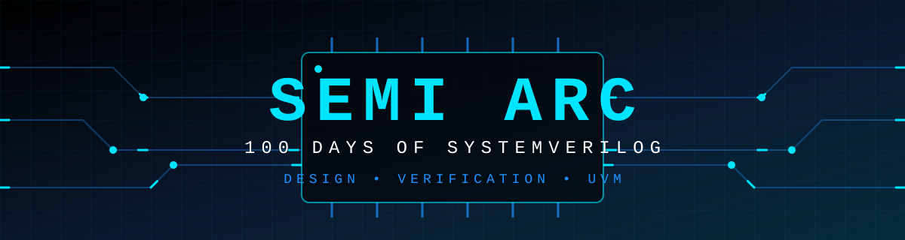

<div align="center">



<br>


<a href="https://github.com/shammy095"></a>
<a href="https://www.linkedin.com/in/shaik-abdul-shammy"></a>

</div>

<br>


**SEMI ARC** is a 100-day engineering journey from digital logic fundamentals to RTL design, SystemVerilog-based functional verification, and an introduction to UVM.

Each day has its own folder with the design files, testbench, and simulation screenshots, all maintained in this single repository. The challenge began on **October 20, 2026**.

<div align="center">


</div>

<br>


I am an **Electronics and Communication Engineering (ECE)** student pursuing a career in **Front-End VLSI Design and Design & Verification Engineering**. This repository is my public record of building that foundation: writing synthesizable RTL, verifying it with structured testbenches, and moving step by step toward industry verification methodology.

<br>


<div align="center">


</div>

<br>


- Build a strong foundation in digital design, from logic gates to sequential systems.
- Write clean, synthesizable RTL in Verilog and SystemVerilog.
- Develop a testbench for every design and validate it through simulation.
- Progress from directed testing toward structured, coverage-aware verification.
- Gain working familiarity with UVM fundamentals.
- Maintain a consistent daily habit with a transparent public record.

<br>


```text
SEMIARC-100-days-of-systemverilog/
├── README.md
├── chip-banner.svg
├── 12/        # Day 12: 4-bit Even Parity Generator
└── ...        # Day folders are added as the challenge progresses
```

Each day folder contains the design files, testbench, and simulation screenshots for that day.

<br>


1. Open a day's folder, for example [`./12/`](./12/).
2. Read the design file, then the testbench.
3. Check the simulation screenshots for results.
4. To run it yourself, clone the repository and simulate in Xilinx Vivado:

```bash
git clone https://github.com/shammy095/SEMIARC-100-days-of-systemverilog.git
```

In Vivado, create a project, add the day's design and testbench, set the testbench as the simulation top, and run **Behavioral Simulation**.

<br>


<div align="center">

<a href="https://github.com/shammy095"></a>
<a href="https://www.linkedin.com/in/shaik-abdul-shammy"></a>

<br>


</div>
